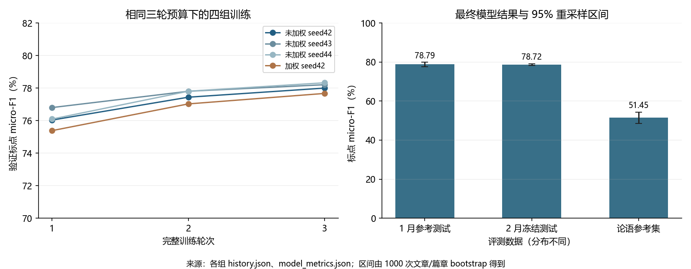
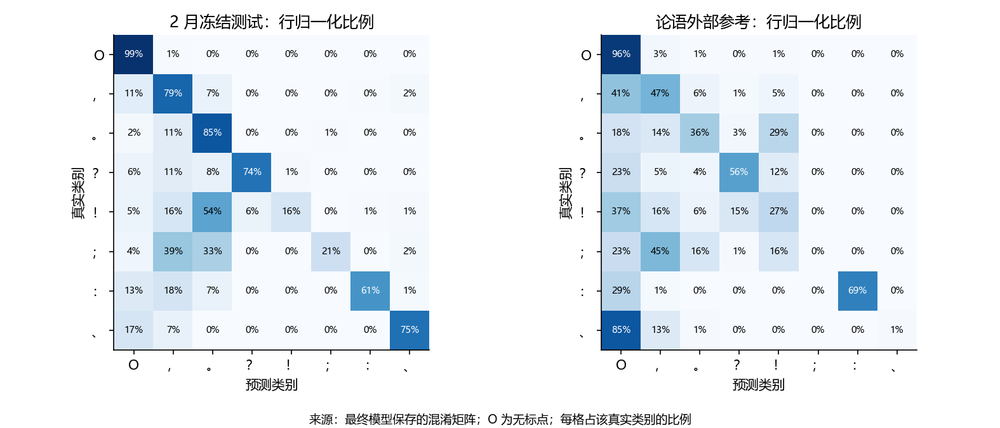
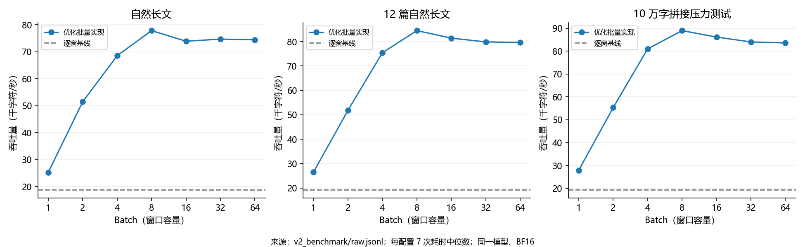

# 高效率 BERT 古文断句标点：微调应用与批量长文推理实验报告

课程：《大模型实践与应用》  
实验项目：使用预训练中文 BERT 完成字符级标点恢复，并优化长文批量推理  
项目目录：`E:\project\bertLab`  
GitHub 仓库：[70clementine/Bert-Lab](https://github.com/70clementine/Bert-Lab)  
报告整理时间：2026-10-15T19:01:41+08:00  
最终模型：`runs/v2_corrected_seed42/best`

> 本报告介绍字符级标点微调、长文批量推理及完整评测。实验数据来自本机实际完成的训练、逐字预测、性能日志和独立审计。正文将实测结果、原因分析和后续设想分别说明。

## 摘要

本实验围绕两个问题展开：如何将现成的中文 BERT 微调为断句标点模型，以及如何在 512 token 上限下高效处理数千字乃至更长的文本。模型将标点恢复转换为“预测每个字符后面的标点”的八分类任务，使用人民日报 1998 年 1 月材料进行全参数微调。工程方案先确定每个字符的唯一输出归属，再为归属区补充上下文，从而提前生成全部窗口并组成 batch。

实验完成三种随机种子的重复训练与一组同预算加权对照，并采用规范词表校验、文章级划分和独立指标重算控制实现风险。最终模型在 1 月参考测试和 2 月冻结测试上的标点 micro-F1 分别为 **78.79%**、**78.72%**；《论语》参考集为 **51.45%**。相同模型下，12 篇自然长文批量推理比按预测句号逐窗推进快 **4.40 倍**，十万字拼接压力输入快 **4.60 倍**。

结果说明，有效利用预训练权重首先依赖输入编码正确；长文提速主要依赖解除窗口之间的顺序依赖，而不是单纯增大 batch。现代新闻上的效果不能直接代表古文质量，固定窗口在古文参考上的 F1 也略低于顺序方案。本文保留这些不足，并给出可核查的失败案例与复现证据。

关键词：BERT；标点恢复；字符级分类；滑动窗口；批量推理；实验复现

## 一、实验内容与研究问题

### 1.1 任务一：从预训练模型得到标点恢复模型

输入是不带目标标点的正文，输出是在原字符之间插入 `，。？！；：、` 的文本。实验使用已经预训练好的 `google-bert/bert-base-chinese`，新增逐位置分类头，再更新 BERT 与分类头的参数。这里“微调”与“从零训练 BERT”不同：前者应当利用既有的词向量和上下文表示，后者需要重新完成大规模语言预训练，本实验没有进行后者。

需要回答的问题包括：标签如何自动生成，如何保证字符与标签对齐，验证集如何选择模型，指标是否真的衡量了标点识别，以及现代语料上的模型迁移到古文后会出现什么问题。

### 1.2 任务二：在长度限制下进行高效率 Batch 推理

题目中的顺序方法每次读取约 400 字，保留前 300 字附近某个句号之前的结果。下一窗口从哪里开始取决于当前预测，因此同一篇文章的窗口不能全部提前送进 GPU。仅把 `batch_size` 参数改大，并不能自动消除这种依赖。

本实验设计固定重叠窗口与唯一输出归属规则，再比较顺序推进、固定窗口参考实现、优化批量实现、无重叠窗口和融合方案。评价同时考虑质量、耗时、显存、边界覆盖和预测一致性，不只比较吞吐量。

### 1.3 本报告如何证明完成了任务

老师没有提供正式评分细则，因此不预估课程分数。报告采用可核查的证据链：每项主要结论对应配置、完整训练记录、保存的预测或计时原始样本；关键实现说明为什么成立，失败实验说明为何未被采用。工程是否完成与模型是否足够好分别判断。

## 二、实验原理与核心实现

### 2.1 将生成问题转为逐字符分类

对清洗后的字符序列 `x₁…xₙ`，令 `yᵢ` 表示第 i 个字符之后的标点。八种标签按 ID 从 0 到 7 固定排列，代码中的准确列表是：

```python
LABELS = ['O', '，', '。', '？', '！', '；', '：', '、']
```

其中 O 表示不插标点。以下只是标签机制示意，不计入测试样本：

```text
带标点：学而时习之，不亦说乎？
字符：  学  而  时  习  之  不  亦  说  乎
标签：  O   O   O   O   ，  O   O   O   ？
```

BERT 为每个输入位置生成上下文表示 `hᵢ`，分类头计算 `zᵢ = W hᵢ + b`，经过 softmax 得到八类概率，推理时取 argmax。对有效监督位置集合 M，未加权损失为：

```text
L = -(1 / |M|) × Σ[i∈M] log p(yᵢ | x)
```

M 包括有监督的 O 位置；只有评分主指标才排除 O 作为目标类。混淆这两点会导致误解“无标点位置是否参与学习”。模型使用逐位置分类，没有 CRF、束搜索或自回归生成过程。所谓 Batch 解码，是多窗口一起前向计算分类结果，并不是逐字生成下一个 token。

### 2.2 输入长度、mask 和标签对齐

本实现为每个保留字符分配一个词表位置，输入形式为 `[CLS] + 字符 ID + [SEP]`。400 字正文对应最多 402 token，再 padding 到 408，低于 512。一般 tokenizer 的“字符数”不必等于 token 数；这里只因采用逐字符映射而能这样换算。

三类位置要分清：padding 的 attention mask 为 0；CLS/SEP 和非归属上下文仍参与注意力计算，但标签为 -100；只有归属区中有监督的字符参与损失与评分。输入上下文可以重复，监督不重复。这避免窗口重叠使部分字符被重复计入训练目标或测试指标。

`WindowDataset.__getitem__` 负责归属区外标签屏蔽，`collate` 负责特殊 token、padding 与 mask。只有 -100 的尾窗被跳过；每轮有 5,354 个实际训练窗口，而原窗口清单有 5,356 个。这个差异有明确原因，不能看到计数不同就直接认定漏训练。

未知字符用 `[UNK]` 参与计算，但输出仍使用保存的原始字符。英文小写及单字符 NFKC 形式仅用于查 ID。这保证输出与清洗后的正文位置对应，但不能赋予模型未见生僻字的独立语义，也不等同于完整 WordPiece 分词。

### 2.3 预训练词表与输入编码的一致性

预训练 embedding 矩阵的第 k 行对应官方词表中 ID=k 的 token。即使输入长度、标签长度和梯度都正常，只要映射有偏差，查到的向量语义也会变化。因此，模型输入不仅要满足形状约束，还要满足词表 ID 的语义约束。

本实验按文件行读取 `vocab.txt`，每行仅移除换行符，并逐项对照独立的 `tokenizer.json`。词表共 21,128 项，其中“我”的 ID 为 2769，Unicode `U+2028` 本身也是合法词条，ID 为 343。不能使用会识别额外 Unicode 行分隔符的字符串拆行方式来随意重建映射。

```python
with vocab_path.open(encoding='utf-8') as reader:
    tokens = [line.rstrip('\n') for line in reader.readlines()]
vocab = {token: index for index, token in enumerate(tokens)}
assert vocab == canonical_vocab  # 从 tokenizer.json 读取的规范映射
```

编码校验分三层：逐项检查完整词表；用常见中文与官方 tokenizer 比较；训练前检查所有缓存 ID 是否与当前编码器一致。checkpoint 同时保存编码规范标记，预测时检查兼容性。四组实验均从同一份原始预训练权重初始化，各组数据编码、标签顺序与模型结构保持一致。

### 2.4 固定窗口如何实现并行

设正文长 N，窗口 W=400，归属步长 S=300。先把输出位置划成不重叠归属区，再为每一区取得足够的上下文。N≤400 时直接一个窗口；更长文本通常在归属区左右各补 50 字，靠近末尾时把输入窗口向前移动到有效范围。

```text
长度 1000 的示例，所有区间左闭右开：
输入 [  0, 400) → 归属 [  0, 300)
输入 [250, 650) → 归属 [300, 600)
输入 [550, 950) → 归属 [600, 900)
输入 [600,1000) → 归属 [900,1000)
```

归属区覆盖 `[0,N)`，两两不重叠；每个归属区都包含在对应输入窗口内。因此每个正文位置有且只有一次输出。窗口坐标完全由 N、W、S 决定，不由预测句号决定，全部窗口可以提前构造。推理按长度排序减少 padding，再跨窗口、跨文章组成 batch，最后依靠原文坐标放回结果。

核心流程可概括为：

```text
对每篇文章：生成 (文章号, 输入范围, 归属范围)
按输入长度排列窗口，分成若干 batch
每个 batch：编码并 padding → BERT 前向 → 每个位置 argmax
仅取各窗口的归属部分，按文章号与位置写回
检查每篇预测长度，插入相应标点
```

长文窗口数约为 `ceil(N/300)`，重叠带来的总输入字数约为 `400N/300`；尾部和短文存在额外边界效应。batch 减少的是前向调用次数与小任务调度开销，并没有把计算量变为常数。BERT 窗口内自注意力仍受窗口长度平方影响，但 W 固定后，总体随 N 近似线性增长。

### 2.5 优化实现与参考实现的关系

`fixed` 和 `fixed_fast` 使用相同的窗口、归属与 argmax 规则。后者去掉推理不需要的 labels 张量，使用 pinned CPU memory 和异步 H2D，把混合精度上下文放到循环外，先在 GPU 上收集归属标签，最后合并回传，减少逐 batch 同步及小块转换。

这与“把窗口规则从顺序推进改成固定归属”是两个层面的改动。前者预期保持相同规则下的输出；后者改变上下文，可能改变质量。实验分别验证它们，不能用“fast 与 fixed 一致”推出“fast 与 sequential 一致”。本版保存整篇输入和输出，内存随 N 增长，不是无限长度流式实现。

## 三、实验数据与配置

### 3.1 数据来源和职责

| 数据角色 | 文章 / 篇数 | 正文字符数 | 使用方式 |
| --- | --- | --- | --- |
| 1 月训练 | 2438 | 1,309,838 | 更新参数 |
| 1 月验证 | 305 | 165,735 | 选择轮次与训练配方 |
| 1 月参考测试 | 305 | 176,393 | 同月份分布参考，不作为最终盲测 |
| 2 月冻结测试 | 2564 | 1,696,014 | 本实验训练与模型选择后评价 |
| 《论语》参考 | 20 | 15,917 | 固定数字版本的跨文体评测 |

人民日报原文件按 GB18030 解码，使用文章编号把段落归为文章。去除语料编号、分词空白和 `{shang5}` 类注音，移除目标标点时把标签写到前一个正文字符上；连续目标符号归并为最后一个。无明确标点的标题或段落末尾标为 -100，避免把缺省编辑信息当作可靠的 O 标签。

四组训练使用固定的 1 月文章划分、正文、标签及编码口径，只改变预定的训练种子或损失配置。非目标 Unicode 标点被去掉，包括引号、括号、书名号、破折号、省略号、百分号和人名间隔号；数字中的小数点保留。该规则有信息损失，所有方案以相同口径评测，并在局限性部分讨论其应用影响。

### 3.2 如何控制数据泄漏

先将相同文章以及共享至少 40 字完全相同段落的文章放入同一连通组，再按组划分训练、验证和测试，最后切窗。否则一篇文章的相邻窗口可能跨集合，共享大量文本，得到虚高分数。当前各集合间没有精确重复文章或满足上述阈值的精确重复段落；未证明不存在近似重复或相似主题。

1 月参考测试用于报告同月份分布下的识别结果，不将其作为未见的最终盲测。最终泛化评估以预留的 2 月冻结测试为主要依据：采用相同清洗规则，检查与整个 1 月的精确重合，实际剔除的跨月重合文章数为 0；其标签不用于训练或模型选择。最终选择文件写好后才进行测试预测。

《论语》使用固定仓库版本中的全部 20 篇、512 个段落，保留来源标点作为参考，不根据模型效果挑选篇目。它是公开著名文本，可能与预训练材料重合，且不同整理版本的标点未必唯一，所以这个指标只表示与该数字版本的一致性，不能称为覆盖古文总体的无污染盲测准确率。

### 3.3 模型、设备与超参数

| 配置项 | 实际配置 |
| --- | --- |
| 基础模型 | google-bert/bert-base-chinese；12 层、768 隐藏维度、12 个注意力头 |
| 固定模型 revision | `8f23c25b06e129b6c986331a13d8d025a92cf0ea` |
| 可训练参数量 | 101,683,208；BERT 和八类分类头全部更新 |
| 设备 | NVIDIA GeForce RTX 5060 Laptop GPU，约 8 GiB 显存 |
| 软件 | Python 3.12；PyTorch 2.7.1+cu128；Transformers 4.51.3 |
| 精度与注意力 | BF16 自动混合精度；SDPA 注意力实现 |
| 窗口 / 归属步长 | 400 / 300；最长含特殊 token 并 padding 后为 408 |
| 单次训练 batch / 梯度累计 | 8 / 2；通常每次更新累计 16 个窗口 |
| 优化器 | AdamW；学习率 3e-5；weight decay=0.01 |
| 学习率调度 | 前 10% 更新 warmup，之后线性衰减 |
| 梯度裁剪 | 最大范数 1.0 |
| 每组训练预算 | 3 轮、1,005 次优化更新 |
| 模型选择 | 每轮验证，保留验证标点 micro-F1 最高的 checkpoint |
| 推理批大小 | 默认 16；性能实验额外比较 1、2、4、8、16、32、64 |

梯度累计降低单次激活显存需求。本实现对各 micro-batch 的平均损失再累计，因此在变长有效 token 数不等时，不应把它说成严格等价于“将全部有效 token 合在一起统一平均”。模型、依赖版本、种子均已固定，但不同硬件和低精度内核仍可能造成细微数值差异。

## 四、实验方案与对照设计

### 4.1 三个需要证据支持的问题

| 问题 | 对照方式 | 保持不变的因素 | 可以支持的结论范围 |
| --- | --- | --- | --- |
| 结果是否依赖单次随机性 | 未加权 seed42、43、44 | 配方、数据和三轮预算 | 本任务上三个种子的结果离散程度 |
| 损失加权是否更合适 | 未加权 seed42 与加权 seed42 | 初始化、数据、学习率、训练步数 | 该加权方法的精确率、召回率和 F1 取舍 |
| 批量方法是否高效且正确 | 相同权重下多解码方法、多 batch | checkpoint、BF16、设备和每组输入 | 本机吞吐收益、输出一致性与窗口质量代价 |

四组实验均完整训练三轮，从同一份预训练权重初始化。未加权与加权的主对照固定 seed42；两个额外种子只用于估计训练随机性。推理算法对照则固定最终权重，只改变窗口和批处理方式，避免同时改变多个因素而无法解释结果。

### 4.2 加权实验的真实含义

设 `n_c` 为训练集中类别 c 的计数，尝试 `w_c=min(3,sqrt(n_O/n_c))`。加权交叉熵按有效位置的目标类权重归一化；权重只使用训练标签计数。

值得注意的是，实际保存的权重为 **`[1,3,3,3,3,3,3,3]`**。即使最常见的逗号，`sqrt(1193548/58839)≈4.50` 也超过上限 3，所以七种标点全部被截断为 3。它主要提高了所有标点相对于 O 的损失代价，没有在七类标点之间实现细致的频率平衡。因此“加权没有提高主指标”不能推出“所有稀有类重平衡都无效”。这也是复核配置数值比只看方法名称更有用的例子。

最终配方只在固定 seed42 的两组中按验证 micro-F1 选择；seed43/44 用于复验，不用于挑选测试分数最高的幸运种子。没有用《论语》成绩反向选择默认权重。

## 五、实际执行流程与测试完整性

### 5.1 从数据到结果的执行顺序

1. 固定预训练模型 revision、原始语料哈希、标签定义和文章级数据划分。
2. 对照规范词表校验全部 21,128 个词条及中文样例，确认编码与预训练 embedding 一致。
3. 准备并逐字核对 1 月缓存，固定各组共享的正文与标签；冻结 2 月与《论语》评测数据。
4. 各组从原始 BERT 初始化；训练时执行前向、损失、反向传播、梯度累计、裁剪和优化器更新；每轮做验证并保存最佳权重。
5. 完成四组训练后，以预先规定的验证主指标选择最终模型，再重新加载 checkpoint 进行各测试集推理。
6. 保存逐字预测，计算整体、分类别、句末、接缝及整篇全对指标；按文章重采样计算区间，再做窗口方法消融。
7. 用相同最终权重单独开展预热与重复性能计时，保存原始样本和输出一致性记录。
8. 用独立统计实现重新计算混淆矩阵和 F1，核对训练完整性、数据划分和计时中位数，最后整理报告。

测试在模型选择之后执行；性能测试与训练分开，不在 GPU 同时训练时测推理速度。所有四组都完成三轮，不是用几步试跑或训练集指标代替最终测试。四组训练合计 12 轮、4,020 次优化更新，训练与验证总耗时约 16.9 分钟。

### 5.2 测试覆盖了什么

| 层次 | 实际检查 | 证据 |
| --- | --- | --- |
| 外部编码规范 | 全词表与 tokenizer.json 完全一致；U+2028=343；“我”=2769；常用中文与官方 tokenizer 对照 | `test_correctness.py`、`vocab_diagnosis.json` |
| 数据与标签 | 注音、全角数值、小数、连续标点、空输入；特殊 token 和无监督位置屏蔽 | 9 项单元测试日志 |
| 窗口不变量 | 0～849 字及 999、1000、3000、10000、100001 等长度，每字符唯一归属且在输入范围内 | `test_correctness.py` |
| 真实 GPU 边界 | 空列表、空文章、未知字、混合长度、300/400/600 附近边界、无效 batch | `gpu-edge-tests.json` |
| 输出一致性 | 完整 1 月测试及古文参考上 fast16 与 fixed16 逐字一致；性能各 batch 与 fixed16 对照 | 两份 equivalence JSON |
| 数据独立性 | 训练/验证/测试与 2 月间无规定条件下的精确重合；所有缓存 ID 逐字核对 | `final-audit.json` |
| 训练完整性 | 四组均三轮、1,005 更新，最佳轮次与验证记录一致 | `history.json`、`completed.json` |
| 指标与耗时 | 从保存预测独立累计混淆矩阵及 F1；复算 33 组中位数、每组七次 | `revision_verify.py` |

这些检查确认的是具体性质，不是“代码永远没有错误”的证明。长度检查与 F1 重算只能验证部分内部关系，不能代替对外部词表规范的核对；数据语义、标签完整性和领域适用性还需要独立分析。

### 5.3 为什么主指标不是普通 accuracy

标点恢复中 O 占多数。如果总是不插标点，也可能获得很高的逐位置 accuracy，却完全不能完成断句任务。1 月全 O 基线的 accuracy 为 **91.40%**，但标点 micro-F1 为 0。

主指标只对七种标点累计：位置和类型均正确记 TP；预测了错误标点类型同时贡献一个 FP 和一个 FN。`P=TP/(TP+FP)`，`R=TP/(TP+FN)`，`micro-F1=2TP/(2TP+FP+FN)`。例如把真实句号预测为逗号，位置对了但标点类型错了，不能记为完全正确。

macro-F1 对七类目标标点等权平均，用于观察常见类别是否掩盖稀有类别；句末 F1 将句号、问号、叹号合并，观察断句位置；整篇全对只看有效监督位置，但对长文很严格。95% 区间使用 1,000 次整篇重采样，《论语》以篇章为单位，避免把相邻字符误当成完全独立的样本。区间没有覆盖全部训练随机性、篇章相关性或预训练重合风险。

## 六、结果与分析

### 6.1 完整训练曲线与模型选择

最终 seed42 未加权组逐轮结果如下：

| 轮次 | 训练交叉熵 | 验证交叉熵 | 验证 micro-F1 | 验证 macro-F1 |
| --- | --- | --- | --- | --- |
| 1 | 0.2185 | 0.0821 | 76.03% | 52.50% |
| 2 | 0.0697 | 0.0766 | 77.44% | 57.43% |
| 3 | 0.0563 | 0.0771 | 78.00% | 59.96% |

四组实验结果如下，全部最佳轮次均为第三轮：

| 组别 | 训练种子 | 损失 | 轮次 / 更新数 | 最佳验证 micro-F1 | 最佳验证 macro-F1 | 训练与验证分钟 |
| --- | --- | --- | --- | --- | --- | --- |
| 未加权 seed42 | 42 | 未加权 | 3 / 1005 | 78.00% | 59.96% | 4.22 |
| 未加权 seed43 | 43 | 未加权 | 3 / 1005 | 78.20% | 61.04% | 4.23 |
| 未加权 seed44 | 44 | 未加权 | 3 / 1005 | 78.32% | 61.30% | 4.22 |
| 加权 seed42 | 42 | 加权 | 3 / 1005 | 77.67% | 61.84% | 4.22 |

训练损失与验证 F1 共同说明学习过程有效，但第三轮仍有改善并不证明训练已达到最优。这里使用固定三轮预算保证对照可比，没有开展更长训练的系统搜索，也没有凭测试分数决定何时停止。

第三轮验证交叉熵从 0.0766 略升到 0.0771，而验证 micro-F1 仍提高。交叉熵衡量概率分配，F1 衡量 argmax 后的标点决策，二者不必同步变化。因此根据预先规定的 F1 选择第三轮是合理的，但不能把这段记录描述成“所有验证指标持续变好”或“完全没有过拟合迹象”。



三个未加权种子的最佳验证 micro-F1 分别为 78.00%、78.20%、78.32%，均值±样本标准差为 78.18±0.17%。在当前配置和数据上结果较为接近，但三个种子仍不足以代表所有训练随机性。

### 6.2 最终测试结果：现代文与古文分别解释

| 数据 | P | R | micro-F1 | 95% 重采样区间 | macro-F1 | 句末 F1 | 整篇全对 |
| --- | --- | --- | --- | --- | --- | --- | --- |
| 1 月参考测试 | 78.78% | 78.80% | 78.79% | 77.67%～79.90% | 61.75% | 83.27% | 5.57% |
| 2 月冻结测试 | 78.83% | 78.61% | 78.72% | 78.29%～79.13% | 61.66% | 83.35% | 6.24% |
| 《论语》参考 | 57.53% | 46.54% | 51.45% | 48.56%～54.38% | 35.48% | 66.77% | 0.00% |

1 月与 2 月结果接近，表明在同报纸、相邻月份的新闻分布上效果相对稳定。但这不是跨年代、跨领域的充分证据，因为新闻来源与表达方式仍相近。整篇全对率只有约 5%～6%，说明局部 F1 看起来较高，也不代表一篇长文可以直接免校对交付。

古文 micro-F1 降至 51.45%，召回率低于精确率，意味着不少应有标点没有被补出。句末 F1 合并了三种句末符号，和严格标点 F1 的目标集合、正确判定均不同，不能把它代替完整标点质量，也不能把二者分差直接解释为标点类型错误率。具体类型混淆应查看混淆矩阵。

全 O 方法的标点 micro-F1 为 0，而最终模型在新闻参考测试中达到 78.79%，说明模型确实学习了标点恢复任务，而不是仅凭大量无标点位置获得高 accuracy。更有区分力的比较来自同预算加权对照和同权重窗口消融，具体结果见后续小节。

### 6.3 随机性和稀有类别

| 数据 | seed42 | seed43 | seed44 | 均值 ± 样本标准差（%） |
| --- | --- | --- | --- | --- |
| 1 月参考测试 | 78.79% | 79.30% | 79.06% | 79.05 ± 0.25 |
| 2 月冻结测试 | 78.72% | 79.01% | 78.91% | 78.88 ± 0.15 |
| 《论语》参考 | 51.45% | 48.87% | 49.47% | 49.93 ± 1.35 |

新闻测试的种子波动较小，《论语》波动更明显。没有因为 seed43 的新闻测试分数更高就换成它，也没有因为 seed42 在古文参考上更高才选 seed42；默认选择规则在读取测试结果前已经规定。

| 标点 | 2 月数量 | 2 月 P | 2 月 R | 2 月 F1 | 古文数量 | 古文 F1 |
| --- | --- | --- | --- | --- | --- | --- |
| ， | 78656 | 79.84% | 79.40% | 79.62% | 1586 | 52.12% |
| 。 | 37303 | 80.38% | 85.28% | 82.76% | 860 | 45.03% |
| ？ | 803 | 72.66% | 74.47% | 73.55% | 301 | 57.68% |
| ！ | 589 | 53.30% | 16.47% | 25.16% | 120 | 10.65% |
| ； | 2507 | 46.48% | 21.30% | 29.21% | 128 | 0.00% |
| ： | 3431 | 71.86% | 61.18% | 66.09% | 788 | 80.98% |
| 、 | 19781 | 75.19% | 75.20% | 75.20% | 93 | 1.90% |

类别结果揭示了总体分数掩盖的问题：2 月分号 F1 只有 29.21%，叹号召回只有 16.47%；古文分号 F1 为 0，顿号 F1 为 1.90%。因此模型并没有均衡掌握七种符号。类别样本量、新闻与古文的编辑习惯差异都可能参与造成这种现象；现有实验没有把这些因素逐个隔离，不能把原因全部归于“样本少”。



### 6.4 没有胜出的加权方案提供了什么信息

| 方案 | 验证 P | 验证 R | 验证 micro-F1 | 验证 macro-F1 | 2 月 micro-F1 | 古文 micro-F1 |
| --- | --- | --- | --- | --- | --- | --- |
| 未加权 seed42 | 77.93% | 78.06% | 78.00% | 59.96% | 78.72% | 51.45% |
| 加权 seed42 | 74.25% | 81.42% | 77.67% | 61.84% | 78.35% | 54.33% |

加权组提高验证召回与 macro-F1，但降低精确率，最终验证 micro-F1 从 78.00% 降为 77.67%。结合实际权重全部标点为 3，可合理推测它让模型更愿意插入标点，从而同时减少漏标、增加误插。这是与结果一致的机制解释，不是已经通过额外因果消融证明的结论。

加权组古文参考分数为 54.33%，高于默认模型，但不能看到这个测试结果后就悄悄改选它，再称古文参考为独立测试。如果课程下一阶段将古文作为主目标，应建立新的古文验证集，预先规定主指标后重新选择。负面实验的价值是明确了目标函数改变带来的取舍，而不是只保留胜出的数字。

### 6.5 窗口方法消融：提速是否付出了质量代价

`sequential` 为按预测句号推进的题目基线；`nonoverlap` 为 300/300 无重叠窗口；`fixed` 为 400/300 唯一归属参考；`fusion` 融合重叠窗口 logits；`all_O` 始终不插标点。所有方法使用同一最终权重。fast 与 fixed16 在完整 1 月测试和古文参考上逐字一致，因此下表 fixed 也代表默认 fast 的质量。

| 数据 | 方法 | micro-F1 | 300 字接缝附近 F1 | 相对 fast 的差值 95% 区间（百分点） |
| --- | --- | --- | --- | --- |
| 1 月参考测试 | all_O | 0.00% | 0.00% | -79.90～-77.67 |
| 1 月参考测试 | sequential | 78.63% | 74.66% | -0.43～+0.12 |
| 1 月参考测试 | nonoverlap | 77.23% | 49.85% | -1.91～-1.20 |
| 1 月参考测试 | fixed | 78.79% | 75.59% | +0.00～+0.00 |
| 1 月参考测试 | fusion | 79.04% | 75.66% | +0.10～+0.42 |
| 《论语》参考 | all_O | 0.00% | 0.00% | -54.38～-48.56 |
| 《论语》参考 | sequential | 53.00% | 51.96% | +0.55～+2.48 |
| 《论语》参考 | nonoverlap | 52.98% | 38.46% | +0.67～+2.34 |
| 《论语》参考 | fixed | 51.45% | 46.59% | +0.00～+0.00 |
| 《论语》参考 | fusion | 51.88% | 47.86% | +0.04～+0.84 |

接缝统一取 300 字归属边界两侧约 10 字的位置，使用相同位置集合比较各方法；它不等于各算法自己的全部边界集合。新闻上无重叠方案接缝 F1 降至 49.85%，固定重叠为 75.59%，支持给边界保留上下文的必要性。不过这一结果不保证所有文体的整体 F1 都提高。

固定批量方案在新闻上与顺序基线接近，在《论语》上却从顺序方案的 53.00% 降为 51.45%，下降约 **1.54 个百分点**。融合在新闻上提高约 0.25 个百分点，但需要额外 logits 聚合。本实验没有用测试分数重新搜索窗口、步长或融合权重，也没有对融合方案另做完整速度—质量前沿评测。

可以确认的是：批量实现能保持同一固定窗口规则的输出；不能确认的是：更换窗口规则完全没有语义代价。即使分数差异的配对区间不含零，也仍受当前单一古文参考版本和多次方法比较影响，不应扩大为普遍优劣排序。

## 七、性能实验与工程收益

### 7.1 公平计时的条件

三种输入分别为 4,020 字自然单文、12 篇自然长文共 28,653 字、100,000 字拼接压力输入。最后一种由测试文章拼接，有人工连接点，只测试性能，不用于质量评价。不能把它称为真实十万字古籍单篇实验。

每配置先做两次预热，在七轮正式测量中随机打乱方法顺序，计时起止显式同步 CUDA。测量包含编码、padding、传输、前向与拼接；不包含加载权重和磁盘读写。CUDA event 另记录前向耗时。否则 Python 可能只测到异步提交时间，给出不真实的加速比。由于端到端包含 CPU 处理，也不能把所有时间都解释为 GPU kernel 执行。

共 33 配置、231 次正式测量，保存全部样本，以中位数汇总。所有已测配置完成，没有静默降低 batch。七次重复只能观察本机波动，不能证明线上服务尾延迟、长期稳定性或不同 GPU 的效果。

### 7.2 主要计时与收益拆分

| 负载 | 最快 fast batch | 相对 sequential | 仅 batch：fixed1→fixed64 | 仅实现：fixed64→fast64 |
| --- | --- | --- | --- | --- |
| single_4020 | 8 | 4.15× | 3.62× | 0.9975× |
| multi_12 | 8 | 4.40× | 3.76× | 1.0245× |
| assembled_100k | 8 | 4.60× | 3.76× | 1.0360× |

| 负载 | 方法 | batch | 窗口数 | 前向次数 | 中位秒 | 字符/秒 | 峰值 allocated MiB |
| --- | --- | --- | --- | --- | --- | --- | --- |
| single_4020 | sequential | 1 | 15 | 15 | 0.2141 | 18,777 | 591 |
| single_4020 | fixed | 1 | 14 | 14 | 0.1950 | 20,619 | 591 |
| single_4020 | fixed | 64 | 14 | 1 | 0.0539 | 74,640 | 714 |
| single_4020 | fast | 8 | 14 | 2 | 0.0516 | 77,863 | 662 |
| single_4020 | fast | 16 | 14 | 1 | 0.0544 | 73,928 | 714 |
| single_4020 | fast | 64 | 14 | 1 | 0.0540 | 74,454 | 714 |
| multi_12 | sequential | 1 | 106 | 106 | 1.4902 | 19,227 | 591 |
| multi_12 | fixed | 1 | 101 | 101 | 1.3850 | 20,689 | 591 |
| multi_12 | fixed | 64 | 101 | 2 | 0.3685 | 77,747 | 1195 |
| multi_12 | fast | 8 | 101 | 13 | 0.3390 | 84,527 | 663 |
| multi_12 | fast | 16 | 101 | 7 | 0.3518 | 81,450 | 735 |
| multi_12 | fast | 64 | 101 | 2 | 0.3597 | 79,654 | 1195 |
| assembled_100k | sequential | 1 | 368 | 368 | 5.1727 | 19,332 | 591 |
| assembled_100k | fixed | 1 | 334 | 334 | 4.6599 | 21,460 | 591 |
| assembled_100k | fixed | 64 | 334 | 6 | 1.2387 | 80,731 | 1195 |
| assembled_100k | fast | 8 | 334 | 42 | 1.1235 | 89,011 | 663 |
| assembled_100k | fast | 16 | 334 | 21 | 1.1603 | 86,183 | 735 |
| assembled_100k | fast | 64 | 334 | 6 | 1.1956 | 83,637 | 1196 |

这里列出对解释收益最重要的 18 个配置；包括 batch=2、4、32 在内的全部 33 个配置、最小/最大值、前向耗时和 reserved 显存见 `runs/v2_benchmark/summary.json`，每次样本见 `raw.jsonl`。

12 篇自然长文的最快配置为 fast batch=8，中位耗时 0.3390 秒，约 84,527 字符/秒，峰值 allocated 显存约 663 MiB。十万字输入耗时 1.1235 秒。allocated 是 PyTorch 跟踪的模型与张量占用，不是显卡所有进程的总显存；也不等于训练显存，后者需要存激活和优化器状态。



### 7.3 为什么 batch=64 没有赢过 batch=8

原先“显存装得下就继续增大 batch”的判断不充分。4,020 字单文只有 14 个固定窗口，batch=16 以后就没有足够窗口填满容量；多文章和十万字输入虽有更多窗口，仍在 batch=8 达到本机测得的最高吞吐。这可能涉及算子形状、并行占用、内存访问和笔记本 GPU 的运行状态，但本实验没有采集内核级性能剖析，不能指定其中某项是已证实的瓶颈。

把 fixed1 与 fixed64 比较，能够隔离同一参考规则下增大 batch 的作用；把 fixed64 与 fast64 比较，能够观察同一 batch 下实现调整的作用。后者在自然单文约为 0.9975 倍，即略慢，在多文章约为 1.0245 倍，在压力输入约为 1.0360 倍。小幅差异可能受波动影响，没有据此宣称统计显著提升。

因此，主要工程贡献是让原本顺序依赖的窗口能够批量计算，而不是把合并回传包装成四倍加速的唯一原因。默认推理仍为 batch=16；本机离线批处理可以显式设为 8。这个硬件参数选择使用性能数据，不改变 checkpoint 或按测试标签调参。

## 八、真实文本案例与应用反思

以下均来自保存的真实文本预测。讨论的是将模型用于新闻整理、古文阅读辅助等场景时的影响；本项目没有实际部署到学校平台、OCR 系统或古籍出版社，也没有进行用户研究。个别例句用于解释现象，不作为新增盲测证据。

### 8.1 古文阅读辅助：熟悉的句子容易掩盖漏标

《论语·学而》节选的输入为：

> 学而时习之不亦说乎有朋自远方来不亦乐乎人不知而不愠不亦君子乎

模型输出：

> 学而时习之，不亦说乎？有朋自远方来不亦乐乎？人不知而不愠，不亦君子乎？

保存的参考标点：

> 学而时习之，不亦说乎？有朋自远方来，不亦乐乎？人不知而不愠，不亦君子乎？

模型识别出了几个反问句，并在“学而时习之”后补出了逗号，但“有朋自远方来”后仍漏逗号。如果只展示一句恰好恢复正确的名句，会高估模型能力；完整 20 篇参考与所有失败位置更有解释力。对于学习辅助，可以把结果作为待核对文本，不能把每处标点直接当作语法或文意的权威讲解。

### 8.2 古籍数字化初稿：流畅不等于断句正确

《桃花源记》节选的模型输出为：

> 晋太元中，武陵人捕鱼为业，缘溪行忘路之远近，忽逢桃花林夹岸数百步中无杂树，芳草鲜美，落英缤纷，渔人甚异之复前行欲穷其林。

保存的参考为：

> 晋太元中，武陵人捕鱼为业。缘溪行，忘路之远近。忽逢桃花林，夹岸数百步，中无杂树，芳草鲜美，落英缤纷。渔人甚异之，复前行，欲穷其林。

模型正确保留了“芳草鲜美”“落英缤纷”等词组的连续性，却把“捕鱼为业”后的句号预测成逗号，漏掉“缘溪行”后的逗号，并将“忽逢桃花林，夹岸数百步，中无杂树”连在一起。读者凭背景知识可能自行补全关系，所以“读起来大致能懂”不是可靠验收标准。

这提示实际整理应同时展示原文、模型输出和人工修改，并保存原始版面符号。现有清洗会去掉引号、括号等，即使七类预测全对，也不等于恢复了完整出版文本。这些编辑流程是场景建议，当前代码没有实现人工审阅界面或 OCR 纠错。

### 8.3 新闻资料恢复：并列项与句末误判影响信息结构

2 月文章 `19980201-01-001`，字符位置 274（从 0 开始）的错误为顿号预测成逗号：

- 参考上下文：席施瓦布和出席本次年会的联合国秘书长安南、瑞士联邦主席兼外长科蒂、一些其他国家的国家元首和政府首脑以及国际组织的领导人，并同他们
- 模型上下文：席施瓦布和出席本次年会的联合国秘书长安南、瑞士联邦主席兼外长科蒂，一些其他国家的国家元首和政府首脑以及国际组织的领导人并同他们

这里需要区分较长人名职务并列项与分句边界。错误不是字符遗漏，而是对结构层次的判断不同。对新闻检索或信息抽取而言，把并列项切成分句可能影响后续实体关系分析；这一影响是应用风险分析，本实验没有实际测量下游抽取性能。

同一文章位置 367 出现 O→句号的误插：

- 参考上下文：士的施瓦布教授于１９７１年创建。该论坛每年１月底至２月初举行一次年会，邀请各国政界和经济企业界领导人以及学者、专家共同探讨全球性
- 模型上下文：士的施瓦布教授于１９７１年创建。该论坛每年１月底至２月初举行一次。年会邀请各国政界和经济、企业界领导人以及学者、专家共同探讨全球性

“举行一次年会”被切成“举行一次。年会邀请……”，两个片段局部都像能读通，但事件结构已变。这是为什么不能只抽几段输出看是否通顺，也不能只统计断句数量。应该保留位置、标签和文章 ID，逐一追踪误判。

这些错误片段按保存文件中的顺序抽取，不是随机代表样本；前后截断也不构成原文错误。特别是接近位置 300 的另一个漏逗号，虽靠近归属边界，却不能仅凭位置把原因全部归为滑窗，仍需同位置跨方法对照才能支持该判断。

### 8.4 批量资料处理：吞吐收益与交付质量分开验收

对一批长文，12 篇输入从约 1.49 秒降至 0.339 秒，说明固定归属批量调度适合离线处理积压文本。实际端到端系统仍有文件读取、OCR、格式恢复和人工校对，本次计时没有包含这些环节，不能说“整个古籍整理流程快了 4.40 倍”。

目前只能证明文本进入本推理过程后的加速。若线上面对单篇短请求，跨请求拼 batch 需要排队，吞吐提高可能增加用户等待时间；代码没有服务队列和延迟 SLA 测试，也不能直接宣称上线收益相同。

## 九、踩坑、失败原因与方法反思

### 9.1 训练收敛不等于所有实现条件都正确

损失下降、输出长度正确和 F1 重算一致，分别说明优化过程、位置对齐与统计计算的部分性质，不能单独证明输入语义与预训练模型匹配。编码 ID、embedding 行号、特殊 token 和标签顺序属于模型接口约束，需要单独核验。

本实验将全词表对照、中文样例对照和缓存逐字对照纳入检查，使编码正确性不只依赖内部自洽。由此得到的方法体会是：应先验证小而关键的接口条件，再讨论是否增加训练轮次；仅用“数据少”或“模型不够大”解释低分，容易忽略可以直接验证的实现因素。

### 9.2 负面结果必须解释实际配置

加权方案没有赢得验证主指标，但它的实际权重饱和说明该实验并未真正区分稀有和常见标点。报告应该写清它检验了什么，而不是用“类别不均衡已解决”结束讨论。本实验固定初始化、学习率和三轮训练预算，仅比较损失配置，避免把训练时间或学习率变化混入加权效果。

### 9.3 优化实现前要写出不变量，再检查预测

窗口并行化的核心不变量是每个原文字符恰好归属一次。这个性质可以用覆盖计数验证，且应覆盖空输入、短文、整除步长和尾部偏移。之后才检查真实 GPU 上相同窗口规则的输出是否一致。单看速度无法发现漏字、重复字或位置放回错误；单看局部样例也无法验证数千字的完整覆盖。

### 9.4 不将测试集变成新的验证集

实验完成后看到古文加权组更高、融合略好、某个种子新闻分数更高，都容易产生“把最好的一项写成最终方案”的冲动。这样会混淆探索与验证。本报告保留原选择，并把这些现象作为下一轮实验假设。后续若据此改配方，应使用新的独立测试材料，不能继续把已看过的测试集称为未见数据。

### 9.5 反思不是编造亲历，而是解释决策

本次可总结的体会来自已保存的代码、日志和预测：预训练输入规范比训练轮数更基础；评价口径决定结论；窗口工程会影响语义质量；失败对照也能排除过强的解释。没有证据支持的人工批注人数、阅读效率提升、部署成功率或用户满意度，不写入实验成果。

## 十、局限性与下一步可验证方案

### 10.1 古文覆盖不足

当前只量化了《论语》一种作品和一个数字整理版本，著名文本还可能出现在预训练材料中。下一步应按作品收集散文、史传、议论等材料，建立互不重叠的训练、验证、测试集合；对存在多种合理标点的片段记录可接受版本，必要时报告双人标注一致性。以上尚未执行，不能算作本实验数据规模或人工评测成果。

### 10.2 清洗不保真与标签覆盖不足

八类标签不能表达成对引号、嵌套书名号和省略号；删除百分号可能改变数字含义，OCR 错字也未处理。后续应建立独立清洗版本，区分待预测的句读符号与应保留的语义符号，固定新的评测口径，再比较文字保留率与标点 F1。不能在同一份“前后对比”里悄悄修改参考答案。

### 10.3 稀有类别与目标函数仍需探索

分号、叹号效果不足，当前加权方法又因截断上限退化为统一标点权重。可在训练侧增加稀有类样本、比较其他权重形式或采样策略，但须控制训练预算，并同时检查精确率、召回率、micro 和 macro-F1。将主指标从新闻 micro-F1 改成古文质量，也应先声明新的目标和验证集。

### 10.4 训练预算不是模型上限

三轮训练与三个种子足以支撑本实验对照，不足以确定最优学习率、最佳轮数或架构上限。没有实验比较 CRF、蒸馏、量化、不同规模 BERT 或其他预训练模型，所以不声称当前方案优于所有替代模型。下一轮可限定计算预算、仅在验证集选择参数，完整报告额外计算成本。

### 10.5 工程与统计外推边界

十万字拼接压力测试不是自然古籍质量测试；O(N) 缓冲不是无限流式方案；单 GPU 的七次计时不是多机稳定性证明。可以进一步做有限队列调度、跨请求 batching、内核 profiling 和更多自然长文评测，分别报告吞吐、等待延迟、显存和质量。当前没有这些结果，报告只对实际测得的工作负载负责。

## 十一、复现方法与证据索引

### 11.1 当前可直接使用的模型

最终权重为 `runs/v2_corrected_seed42/best/model.safetensors`。本机已配置独立 `.venv`，没有修改 Anaconda base；完整依赖见 `requirements.txt` 和 `requirements-lock.txt`。原始模型固定 revision 为 `8f23c25b06e129b6c986331a13d8d025a92cf0ea`。

```powershell
Set-Location E:\project\bertLab
& .\.venv\Scripts\python.exe bert_punct.py predict --text "学而时习之不亦说乎有朋自远方来不亦乐乎" --method fast --batch-size 8
& .\.venv\Scripts\python.exe bert_punct.py predict --input input.txt --output output.txt --method fast --batch-size 8
```

文件输入采用 UTF-8。输出对应清洗后的正文；不要把它误当成保留原排版的文档转换工具。预测入口从 `config.json` 指定的 checkpoint 加载权重，复现时应使用本节列出的路径与对应编码规范。

### 11.2 无需重训即可核验的内容

```powershell
& .\.venv\Scripts\python.exe -m unittest test_correctness -v
& .\.venv\Scripts\python.exe verify_gpu_edges.py
& .\.venv\Scripts\python.exe revision_verify.py
```

前两条检查编码、窗口和真实 GPU 行为；第三条基于已保存的数据与预测独立复算。完整数据与权重保存在本机项目，轻量代码压缩包没有包含大权重、虚拟环境和完整语料，因此不是脱离数据就能独立运行的模型发布包。

### 11.3 从数据准备到完整重训的顺序

下面记录完整流程，不表示本次撰写报告时又重跑了一次训练。已有完成的 run 会被保护；如需重训，应先保存当前记录，为四份 `configs/*.json` 指定新的 `run_dir`，且备份评测输出目录。`revision_data.py` 在存在处理缓存时保留其划分；首次克隆没有缓存时，按固定配置从原始语料生成划分。复现本报告需要使用清单中同一来源与哈希的语料，不能假定任意同名文本都能得到相同结果。

```powershell
& .\.venv\Scripts\python.exe revision_data.py
& .\.venv\Scripts\python.exe prepare_classical.py
& .\.venv\Scripts\python.exe bert_punct.py train --config configs/corrected_seed42.json
& .\.venv\Scripts\python.exe revision_train.py
& .\.venv\Scripts\python.exe revision_evaluate.py
& .\.venv\Scripts\python.exe revision_benchmark.py --repeats 7
& .\.venv\Scripts\python.exe verify_gpu_edges.py
& .\.venv\Scripts\python.exe revision_verify.py
```

`revision_train.py` 执行其余三个配置，并跳过已完成组。模型选择与测试由 `revision_evaluate.py` 完成。报告由 `write_new_report.py` 读取当前实验记录整理；该脚本的分析文字面向本次固定配置，后续开展不同实验时需要根据实际记录重新核对结论。文件路径采用项目中的真实名称，便于定位配置、模型与证据。

### 11.4 主要结论对应哪些文件

下表是完整实验运行时的项目路径。GitHub 仓库将可公开核查的轻量指标、训练记录与数据清单放在 `results/`，报告图片位于 `artifacts/`；虚拟环境、原始及完整处理语料、大权重和逐字预测不随仓库上传。安装、训练与测试步骤见仓库 README 和 `docs/复现说明.md`。

| 要核查的内容 | 项目相对路径 |
| --- | --- |
| 规范词表与中文编码检查 | `test_correctness.py`、`artifacts/v2/unit-tests.txt` |
| 数据来源、数量、哈希与划分 | `data/v2/manifest.json`、`february_manifest.json`、`classical_manifest.json` |
| 实际加权系数 | `runs/v2_weighted_seed42/class_weights.json` |
| 每轮损失、验证结果与完整训练 | 各 `runs/v2_*seed*/history.json`、`steps.jsonl`、`completed.json` |
| 默认模型为何被选中 | `runs/v2_evaluation/selection.json` |
| 各模型各数据集指标及区间 | `runs/v2_evaluation/model_metrics.json` |
| 解码方法消融及配对区间 | `runs/v2_evaluation/method_metrics.json` |
| 每篇每字的预测 | `runs/v2_evaluation/模型名/数据集.jsonl`；方法消融在 `methods/` |
| 古文示例与新闻错误位置 | `runs/v2_evaluation/classical_examples.json`、`february_errors.jsonl` |
| 231 次真实计时 | `runs/v2_benchmark/raw.jsonl` |
| 性能汇总、收益与输出一致性 | `runs/v2_benchmark/summary.json`、`gains.json`、`equivalence.json` |
| 9 项单元测试、GPU 检查和独立审计 | `artifacts/v2/unit-tests.txt`、`gpu-edge-tests.json`、`final-audit.json` |
| 报告与数据来源哈希 | `artifacts/v2/new-report-check.json` |

若只看报告表格无法确定结论是否真实，应当从这些文件反向检查。保存逐字预测比只保存一个最终 F1 更重要，因为前者允许独立重算、检查类别混淆和定位失败样本。

## 十二、结论

任务一完成了从既有中文 BERT 到标点模型的全参数微调，包含规范编码、标签对齐、完整训练、验证选模与独立评测，并用重复种子和同预算损失对照检查结果。任务二通过固定重叠窗口和唯一归属解除顺序依赖，完成多窗口及多文章 batch 推理，并有质量消融、重复性能计时与预测一致性检查。

新闻参考测试 micro-F1 为 78.79%，冻结跨月测试为 78.72%；本机批量长文推理得到约 4.40～4.60 倍加速。但古文参考只有 51.45%，固定窗口还存在相对顺序方案的小幅质量损失，稀有标点和格式保真问题仍未解决。项目可以作为可复现的课程实验和辅助标点原型，不能据此承诺古籍整理的最终质量。

本实验体现的主要能力应由证据判断：能说明模型为什么这样建模、训练与测试如何隔离、并行算法为什么不漏字、失败为什么发生，以及结论可以推广到哪里。报告完整不等于实验没有不足；把不足和反例解释清楚，是可信实验的一部分。

## 参考资料与协作说明

1. [BERT 原论文](https://arxiv.org/abs/1810.04805)：预训练与下游任务微调原理。
2. [中文 BERT 固定模型版本](https://huggingface.co/google-bert/bert-base-chinese/tree/8f23c25b06e129b6c986331a13d8d025a92cf0ea)：原始预训练权重与词表来源。
3. [Transformers 4.51.3 的 BERT 词表读取源码](https://github.com/huggingface/transformers/blob/v4.51.3/src/transformers/models/bert/tokenization_bert.py)：规范读取行为的对照依据。
4. [固定版本的《论语》参考数据](https://raw.githubusercontent.com/chinese-poetry/chinese-poetry/b8594f81a89752241442f2ce267d6f66f96704ee/%E8%AE%BA%E8%AF%AD/lunyu.json)：公开数字文本；整理标点不是唯一可接受答案。
5. 本机实验配置、源码、训练日志和逐字预测：以上证据索引中的文件。

本项目的代码编写、调试与报告整理使用 AI 辅助，训练、推理和计时结果来自本机实际执行。本文的场景反思以已保存输出为依据；场景建议不代表已经完成部署或用户研究。
